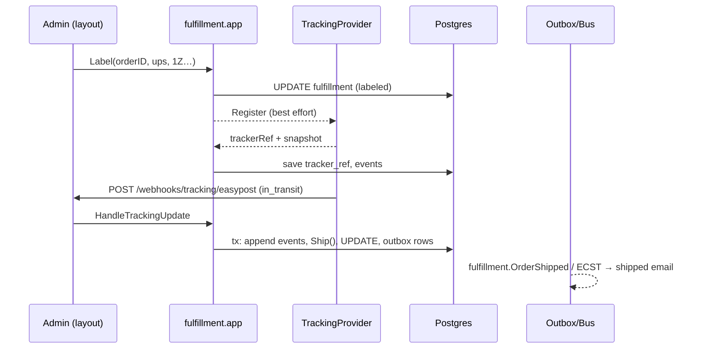

# Tech spec: Package tracking across major US carriers

PRD: [prd.md](./prd.md) · Status: Draft

## 1. Summary
Extend the `fulfillment` bounded context with a carrier-agnostic **tracking** capability.
- A `TrackingProvider` port is implemented by an aggregator adapter (proposed: EasyPost) and a `fake` adapter for dev, CI and demo.
- The provider sends updates to `POST /webhooks/tracking/{provider}`. A leader-locked poller backs this up, using the same pattern as `checkout/sweeper`.
- Updates are normalized into `TrackingEvent`s and stored in a new `fulfillment_tracking_event` table.
- Updates drive the existing `Fulfillment.Ship` / `Deliver` transitions, so the current integration events (`fulfillment.OrderShipped`, `OrderShippedECST`, `OrderDelivered`) and emails keep working unchanged.
- `layout` gets a carrier dropdown, a shipment timeline partial and two new emails.

## 2. Context
- `backend/fulfillment/domain/fulfillment.go`: state-stored `Fulfillment` with `carrier` and `trackingCode` as free strings. Its transitions are `Label` (scheduled→labeled), `Ship`, `Deliver`, `Refund`, `SetTracking` and `AdminOverrideStatus`. Optimistic concurrency uses the `version` column.
- `backend/fulfillment/app/service.go`: the load → command → save → drain-events pattern. Integration events are staged through the transactional outbox (`internal/outbox`).
- `backend/layout/http_admin_orders.go`: free-text `carrier` / `tracking_code` on `AdminShipOrder` (Label + Ship) and `AdminUpdateOrderStatus`. `UpdateTracking` is currently written to **both** `checkout` (`CheckoutService.UpdateTracking`) and `fulfillment`.
- Templates: `layout/tmpl/order/show.gohtml` and `layout/tmpl/admin/order_detail.gohtml` render `carrier: … · tracking: <code>…</code>`.
- Emails: `layout/emails.go` (`RenderOrderShipped` from the ECST event) and `internal/mailer` `Kind*` constants. `order_delivered` already exists.
- Patterns to reuse:
  - `payments/adapter/stripe_adapter.go`: an external API anti-corruption layer (ACL) behind a port, with a configurable endpoint and `http.Client`.
  - `layout/http_payments_webhook.go`: translates provider vocabulary at the boundary.
  - `checkout/sweeper`: periodic worker with a Postgres advisory lock.
  - `cmd/web/config.go`: `conf` env config with `mask` for secrets.
- ADR context: fulfillment is a **Core** subdomain and state-stored by design (`docs/subdomains.md`). Tracking events are operational history, not money, so they're also state-stored (append-only rows, no event sourcing).

## 3. Design

### Bounded contexts touched
| Context | Change |
|---|---|
| `fulfillment` | **domain:** `Carrier`, `TrackingNumber`, `TrackingStatus`, `TrackingEvent`, `Fulfillment.ApplyTracking`. **app:** `RegisterTracking`, `HandleTrackingUpdate`, `RefreshTracking`, `ListTrackingEvents`, ports `TrackingProvider` + `TrackingEventStorage`. **adapter:** Postgres/in-memory storage, `easypost` + `fake` providers. New `tracker/` poller package. New integration events. |
| `layout` | Carrier `<select>` + validation, shipment card partial (storefront + admin), refresh endpoint, webhook handler, exception filter, two email renderers. |
| `checkout` | No new behavior. `UpdateTracking` stays for replay/back-compat, but `layout` stops calling it (fulfillment is the single source of truth). See §8. |
| `internal/mailer` | Add `KindOrderOutForDelivery`, `KindDeliveryException`. |
| `cmd/web` | Config, wiring of provider, poller, webhook secret, and bus subscriptions for new emails. |

### Domain model (`fulfillment/domain`)
- `Carrier` value object: `ups | usps | fedex | dhl_express | other`.
  - `ParseCarrier(string)` accepts legacy free-text values case-insensitively ("UPS", "Fedex"). Anything unrecognized maps to `other`.
  - `Carrier.TrackingURL(number)` returns the public carrier link (static templates per carrier).
- `TrackingNumber`:
  - `NewTrackingNumber(carrier, raw)` normalizes (uppercases, strips spaces) and validates format per carrier. Examples: UPS `^1Z[0-9A-Z]{16}$`; USPS 20–22 digits or `^[A-Z]{2}\d{9}US$`; FedEx 12/15/20/22 digits; DHL Express 10 digits.
  - `other` skips validation.
  - `DetectCarrier(raw) []Carrier` returns candidates for the auto-suggest.
- `TrackingStatus`: `pre_transit | in_transit | out_for_delivery | delivered | exception | returned_to_sender | unknown`.
- `TrackingEvent` (value):
  - `ProviderEventID`, `Status`, `CarrierStatusCode`, `Description`, `Location` (city/state/zip/country), `OccurredAt`, `ReceivedAt`.
- `TrackingUpdate` (command input): the provider's current snapshot, made of `Status`, `ETA *time.Time` and `Events []TrackingEvent`.
- New `Fulfillment` fields:
  - `trackingStatus`
  - `trackingETA`
  - `trackerRef` (the provider's tracker id)
  - `lastTrackedAt`
  - `autoTracking bool` (default true; set false by `AdminOverrideStatus`, per AC-10)
- `Fulfillment.ApplyTracking(update, at) (newEvents []TrackingEvent, err)`:
  1. Dedupe incoming events against already-known `ProviderEventID`s (the service passes the known set). This covers AC-5.
  2. Set `trackingStatus` and `trackingETA` from the latest event by `OccurredAt`, never by arrival order. Status never regresses from `delivered` (AC-6).
  3. If `autoTracking` is on, apply the transition rules:
     - status ∈ {in_transit, out_for_delivery} and fulfillment `labeled` → call `Ship(firstScan.OccurredAt)`.
     - status = delivered and fulfillment `labeled` → call `Ship` then `Deliver` (open question #3).
     - status = delivered and fulfillment `shipped` → call `Deliver(deliveredEvent.OccurredAt)`.
  4. Raise a `TrackingStatusChanged{ID, OrderID, From, To, At}` domain event when the normalized status changes.

  Reusing `Ship` / `Deliver` keeps the existing guards and events: there's no new path to `shipped` / `delivered`.
- `Label(carrier Carrier, number TrackingNumber, at)` replaces the string arguments. `SetTracking` gets the same typed arguments and resets `trackerRef`, `trackingStatus` and `autoTracking`.

### Data model and migrations
`migrations/000046_fulfillment_tracking.up.sql`:
```sql
ALTER TABLE fulfillment
  ADD COLUMN tracking_status   text NOT NULL DEFAULT 'unknown'
      CHECK (tracking_status IN ('pre_transit','in_transit','out_for_delivery','delivered','exception','returned_to_sender','unknown')),
  ADD COLUMN tracking_eta      timestamptz,
  ADD COLUMN tracker_provider  text NOT NULL DEFAULT '',
  ADD COLUMN tracker_ref       text NOT NULL DEFAULT '',
  ADD COLUMN last_tracked_at   timestamptz,
  ADD COLUMN auto_tracking     boolean NOT NULL DEFAULT true;

CREATE TABLE fulfillment_tracking_event (
  id                 text PRIMARY KEY,
  fulfillment_id     text NOT NULL REFERENCES fulfillment(id) ON DELETE CASCADE,
  provider_event_id  text NOT NULL,
  status             text NOT NULL,
  carrier_status     text NOT NULL DEFAULT '',
  description        text NOT NULL DEFAULT '',
  city               text NOT NULL DEFAULT '',
  state              text NOT NULL DEFAULT '',
  zip                text NOT NULL DEFAULT '',
  country            text NOT NULL DEFAULT '',
  occurred_at        timestamptz NOT NULL,
  received_at        timestamptz NOT NULL DEFAULT now(),
  UNIQUE (fulfillment_id, provider_event_id)
);
CREATE INDEX fulfillment_tracking_event_ff_idx ON fulfillment_tracking_event(fulfillment_id, occurred_at DESC);
CREATE INDEX fulfillment_tracking_status_idx ON fulfillment(tracking_status) WHERE tracking_status IN ('exception','returned_to_sender');
CREATE INDEX fulfillment_poll_idx ON fulfillment(last_tracked_at) WHERE tracker_ref <> '' AND tracking_status NOT IN ('delivered','returned_to_sender');
```
- `000046_fulfillment_tracking.down.sql` drops the table, the indexes and the added columns.
- **Backfill:** a one-off CLI command `cli fulfillment normalize-carriers` normalizes existing `carrier` strings to `Carrier` codes. Unmatched values become `other`. Existing in-flight shipments aren't registered automatically. Admins can press **Refresh tracking** to register one.
- `provider_event_id` falls back to `sha256(occurred_at|status|description|zip)` when the provider gives no id. The unique constraint enforces idempotency (AC-5).
- **PII:** raw provider payloads are not stored. Only the normalized fields above are kept.

### Application layer (`fulfillment/app`)
```go
type TrackingProvider interface {
    Name() string
    Register(ctx context.Context, c domain.Carrier, n domain.TrackingNumber) (trackerRef string, snap domain.TrackingUpdate, err error)
    Fetch(ctx context.Context, trackerRef string) (domain.TrackingUpdate, error)
    // ParseWebhook verifies the signature and translates the provider payload.
    ParseWebhook(r *http.Request) (trackerRef string, upd domain.TrackingUpdate, err error)
}
type TrackingEventStorage interface {
    Append(ctx context.Context, fulfillmentID string, evs []domain.TrackingEvent) (inserted []domain.TrackingEvent, err error) // ON CONFLICT DO NOTHING
    List(ctx context.Context, fulfillmentID string) ([]domain.TrackingEvent, error)
    KnownIDs(ctx context.Context, fulfillmentID string) (map[string]struct{}, error)
}
```
- `Label` / `UpdateTracking` save first and commit. Then they call `RegisterTracking` on a best-effort basis: a provider error is logged and the poller retries later. This keeps admin labeling working through provider outages.
- `HandleTrackingUpdate(ctx, provider, trackerRef, upd)`:
  1. Find the fulfillment by `(tracker_provider, tracker_ref)`.
  2. In one transaction: `Append` events, apply `ApplyTracking`, then `Update` with an optimistic lock. On `ErrOptimisticLock`, retry up to 3 times.
  3. Drain pending events to the outbox in the same transaction.
- `RefreshTracking(ctx, orderID)`: `Fetch`, then `HandleTrackingUpdate`. Registers first if `trackerRef` is empty.
- `ListTrackingEvents(ctx, orderID)` serves the read side for templates.
- **New integration events** in `fulfillment/integration`. Both use the ECST style, so emails don't call back into checkout:
  - `TrackingStatusChanged{OrderID, Carrier, TrackingCode, From, To, ETA, At}`, wire name `fulfillment.TrackingStatusChanged`.
  - `TrackingStatusChangedECST{...OrderShippedECST fields + Status, ETA, LastEvent}`.

### Poller (`fulfillment/tracker`)
- Copies the `checkout/sweeper` structure: a `Locker` with a new advisory lock id, an interval from config, and OTel spans.
- Each tick:
  1. Select up to N fulfillments from `fulfillment_poll_idx` where `last_tracked_at < now() - pollAge(status)`. `pollAge` is `pre_transit`: 6 h, `in_transit`: 3 h, `out_for_delivery`: 30 min, `exception`: 1 h.
  2. Call `RefreshTracking` for each.
  3. Rows with `tracker_ref = ''` and a supported carrier get `RegisterTracking`, which covers registrations that failed earlier.
- Polling stops at the terminal statuses `delivered` and `returned_to_sender`.

### Adapters
- `adapter/easypost.go`: `EasyPostConfig{APIKey, WebhookSecret, Endpoint, HTTPClient}`.
  - `POST /v2/trackers` to register, `GET /v2/trackers/{id}` to fetch.
  - Webhook: verifies the HMAC-SHA256 `X-Hmac-Signature` header over the raw body (AC-11).
  - Status mapping table: `pre_transit→pre_transit`, `in_transit→in_transit`, `out_for_delivery`, `delivered`, `failure|error→exception`, `return_to_sender→returned_to_sender`, everything else → `unknown`.
  - Carrier code mapping: `UPS`, `USPS`, `FedEx`, `DHLExpress`.
- `adapter/fake_tracking.go`: deterministic. `Register` returns `fake_<id>`, and `Fetch` derives progress from elapsed time since registration. The default schedule is 2 min per step, configurable. The webhook path accepts unsigned requests only when `Env=dev`. Used in tests, CI, `APP_DEMO=true`, and whenever no API key is set (AC-9).
- Postgres and in-memory `TrackingEventStorage`, plus a `FindByTracker` method on the existing storage.

### HTTP / HTMX (`layout`)
| Method | Route | Handler | Auth | Notes |
|---|---|---|---|---|
| POST | `/webhooks/tracking/{provider}` | `TrackingWebhook` | provider signature, CSRF-exempt (like the payments webhook) | 200 on success or unknown tracker. 401 on a bad signature. Rate-limited via `ratelimits.go`. |
| POST | `/admin/orders/{orderID}/tracking/refresh` | `AdminRefreshTracking` | admin + CSRF | Returns the `shipment_card` partial (HTMX swap). |
| GET | `/admin/orders?delivery=issues` | `AdminOrders` (existing) | admin | Filters on `tracking_status IN (exception, returned_to_sender)`. |
| POST | `/admin/orders/{orderID}/ship`, `/status` (existing) | existing | admin + CSRF | The carrier becomes a `<select>`. Validation errors re-render the form with field messages (AC-2). |
| GET | `/order/{orderID}` (existing) | `Order` | owner (existing) | Renders `shipment_card` from stored events (AC-7). |

Templates:
- New `layout/tmpl/partials/shipment_card.gohtml`, used by both the storefront and the admin.
- Emails: `order_out_for_delivery.{html,txt}.tmpl` and `delivery_exception.{html,txt}.tmpl`. `order_shipped.*` gets a tracking-link button.
- Carrier auto-suggest: `hx-get="/admin/tracking/detect?number=…"` with `hx-trigger="keyup changed delay:300ms"`, which returns `<option selected>`. This is optional ("Should").

### Key flows


## 4. Alternatives considered
| Option | Pros | Cons | Why not |
|---|---|---|---|
| **Aggregator, EasyPost (chosen)** | One integration for all four carriers. Webhooks. Per-tracker pricing. Normalized statuses. | Vendor dependency and cost per tracker. | Lowest effort. Swappable behind the port. |
| Direct carrier APIs (UPS, USPS, FedEx, DHL) | No middleman, no per-tracker fee. | Four OAuth flows, four schemas, carrier account onboarding, and polling-only for some carriers. About 4× the build and maintenance. | Too costly for v1. Can be added later as extra `TrackingProvider` adapters. |
| Shippo / AfterShip | Similar features. AfterShip has hosted tracking pages. | AfterShip is subscription-priced. Shippo's tracking is tied to its label product. | Comparable. Kept as an open question. |
| Links only (no API) | Trivial. | No status, no automation, no exceptions. | Misses most PRD goals. Shipped as the `other` fallback. |
| Store tracking on the checkout `Order` aggregate | Already has `UpdateTracking`. | Mixes operational state into the event-sourced commercial aggregate, against the Process Manager split. | Violates the existing context boundaries. |

## 5. Edge cases and failure modes
- **Duplicate or out-of-order updates:** the unique `(fulfillment_id, provider_event_id)` constraint, status derived from the latest `OccurredAt`, and no regression from `delivered` (AC-5, AC-6).
- **Concurrent webhook and poll:** optimistic lock with retry. Event inserts are `ON CONFLICT DO NOTHING`.
- **Tracking number changed after registration:** `SetTracking` resets the tracker. The old tracker's webhooks no longer match the new `tracker_ref` and are ignored with 200.
- **Refunded fulfillment:** events are still appended for the timeline, and no transitions happen (`Ship` / `Deliver` guards reject them).
- **Admin override:** `autoTracking=false`. Events are still appended, and no transitions happen (AC-10).
- **Provider down:** labeling succeeds, registration is retried by the poller, and the UI shows "Tracking pending".
- **Unknown carrier status:** stored as `unknown` with the raw `carrier_status` shown in the timeline.
- **Exception emails:** sent once per transition *into* `exception`, not once per exception event.
- **Time zones:** `occurred_at` is stored in UTC. The timeline renders it with the event location's offset when the provider supplies one, otherwise in UTC.

## 6. Security and privacy
- Webhook HMAC verification uses a constant-time compare and is CSRF-exempt. The body size limit (64 KB) and rate limit reuse the payments webhook setup.
- New config: `TRACKING_PROVIDER` (`fake|easypost`, default `fake`), `TRACKING_EASYPOST_API_KEY` (`mask`), `TRACKING_WEBHOOK_SECRET` (`mask`), `TRACKING_POLL_INTERVAL` (default 5m). Prod boot fails if `TRACKING_PROVIDER=easypost` and either secret is empty.
- Only normalized event fields are stored. No recipient names or signatures.
- Storefront authz is unchanged: the shipment card renders only inside the already-authorized `/order/{id}` handler.

## 7. Testing plan
| AC | Test type | Location |
|---|---|---|
| AC-1, AC-2 | unit (validation, detection) + layout e2e | `fulfillment/domain/tracking_test.go`, `layout/http_admin_orders_tracking_test.go` |
| AC-3, AC-4, AC-6, AC-10 | unit on `ApplyTracking` (table-driven) + service test with in-memory storage | `fulfillment/domain/fulfillment_tracking_test.go`, `fulfillment/app/tracking_test.go` |
| AC-5 | integration (Postgres, unique constraint, concurrent webhook + poll) | `backend/integration/tracking_idempotency_test.go` |
| AC-7 | layout template test (storefront card, authz) | `layout/http_order_tracking_test.go` |
| AC-8 | service + email render tests | `layout/emails_test.go` |
| AC-9 | fake provider unit test + demo-mode e2e | `fulfillment/adapter/fake_tracking_test.go`, `layout/http_demo_mode_e2e_test.go` |
| AC-11 | webhook handler test (bad / good signature) using an `httptest` EasyPost fixture | `fulfillment/adapter/easypost_test.go`, `layout/http_tracking_webhook_test.go` |

Carrier status mapping gets a golden table test per carrier. Commands: `make tests`, `make integration` (requires Postgres + `migrate`), and `golangci-lint` v2.12.2, matching CI.

## 8. Rollout
1. Ship migration 000046. It's additive, and existing rows get defaults.
2. Deploy code with `TRACKING_PROVIDER=fake` in staging. Verify end to end with demo mode.
3. Configure the EasyPost key and webhook secret in staging, register the webhook URL, and smoke-test with the EasyPost test-mode tracking numbers.
4. Run `cli fulfillment normalize-carriers` in prod, then enable `easypost`.
5. **Clean-up follow-up:** stop dual-writing tracking to `checkout` (`CheckoutService.UpdateTracking`). It stays for replay. Remove the legacy `.Order.Carrier` fallback in templates once all live orders have a fulfillment.

**Rollback:** set `TRACKING_PROVIDER=fake` (or `none`). The UI falls back to the static carrier link. The down migration is safe because the data is derived and re-fetchable.

## 9. Observability
- OTel spans `Fulfillment.HandleTrackingUpdate`, `Tracker.Poll` and `TrackingProvider.{Register,Fetch}`, with carrier and status attributes.
- Metrics:
  - `tracking_updates_total{provider,source=webhook|poll,status}`
  - `tracking_register_failures_total`
  - `tracking_auto_transitions_total{to}`
  - `tracking_webhook_rejected_total`
- Admin: "Last checked" timestamp on each order and the delivery-issues filter.

## 10. Task breakdown
1. Domain: `Carrier`, `TrackingNumber`, `TrackingStatus`, `TrackingEvent`, `ApplyTracking` + tests. *(M)*
2. Migration 000046, Postgres/in-memory storage, `FindByTracker` + integration tests. *(M)*
3. `TrackingProvider` port, fake adapter, service methods, outbox events. *(M)*
4. EasyPost adapter + webhook signature + mapping tables + fixtures. *(M)*
5. Poller with advisory lock, config and wiring in `cmd/web`. *(S)*
6. Admin UI: carrier select, validation, shipment card, refresh, exceptions filter. *(M)*
7. Storefront shipment card + emails (shipped link, out-for-delivery, exception). *(M)*
8. CLI backfill, docs (glossary entries for Carrier / TrackingEvent), README feature list. *(S)*

Each task is one PR, in order 1→8. Tasks 6 and 7 can run in parallel after task 3.

## 11. Open questions
| # | Question | Proposed default | Decision |
|---|---|---|---|
| 1 | Provider choice (see PRD Q1). | EasyPost | |
| 2 | Should the poller run in the web process or as a separate `cli` worker? | In-process goroutine with an advisory lock, like the sweeper. | |
| 3 | Keep the dual write to `checkout.Order` tracking during the transition? | Yes for v1, removed in the clean-up follow-up. | |
| 4 | How long should tracking events be retained? | Indefinitely (small rows). Revisit with data-retention policy. | |

## Changelog
- 2026-11-15: initial draft
